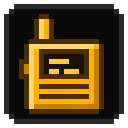
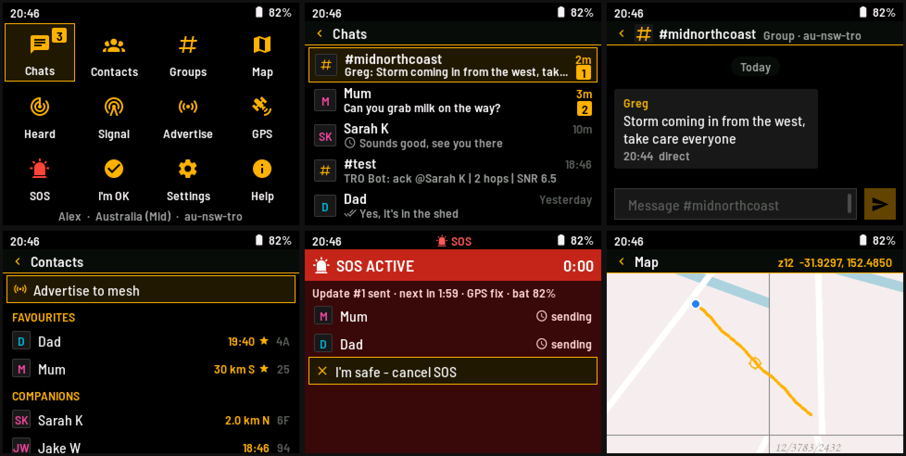

# EasyDeck: MeshCore firmware for the LilyGO T-Deck Plus

EasyDeck turns a T-Deck Plus into a standalone MeshCore messenger. You don't need a phone: the
keyboard, trackball, GPS and screen do everything. It's free and open source, a community alternative to
Ripple and MeshOS, and it talks to every other MeshCore node, app and repeater.

It started as firmware for our local mesh on the NSW Mid North Coast, so it defaults to the
**Australia (Mid)** preset. It works anywhere MeshCore does: pick your region's preset in setup.

**What it's for:** chatting with friends and family off-grid, knowing where your people are,
getting help when something goes wrong, and keeping an eye on the local mesh. All of that comes
in a UI you can use with gloves on, or hand to someone who's never seen a T-Deck.

## Safety & legal

**EasyDeck is not real SOS or safety equipment.** Its SOS only reaches people on the mesh, delivery
is never guaranteed, and it does not contact 000 or any emergency service. In an emergency call
**000**, and carry a registered PLB or satellite messenger where there is no mobile coverage.
Weather and warnings shown on the device are informational, not official warnings. It is free
software provided as is, with no warranty. You are responsible for using your radio within your
local rules (in Australia, the ACMA LIPD class licence for 915-928 MHz). Full notice:
[docs/LEGAL.md](docs/LEGAL.md).

## What you get

### Messaging
- **Direct messages** with delivery ticks. Failed messages retry on their own, and you can resend with one press.
- **Channels:** public `#hashtag` channels and private channels with a secret key. Room servers
  are supported too, and you're logged back in automatically after a reboot.
- **See where your message went:** on your channel messages, "heard by 3 repeaters" tells you
  how far a message got, and *which* repeaters carried it. Roll up to any message to reply, quote
  it or open its details.
- **Emoji, properly:** the whole SerenityOS pixel-art set (the same one mesh.nah.rocks uses),
  almost 2000 emoji including every flag. Repeater and contact names with emoji in them finally
  look right. Roll the trackball right in a chat for the picker, then type to search ("heart",
  "flag aus"). Shortcodes like `:fire:` and `:)` work while you type.
- **Quick replies** for when typing is a pain: "On my way", "Running late", "Call me when you can", or your location.
- **Search** every conversation with `/`, and jump to the next unread with `$`.
- **Per-channel mute and tones:** a busy channel can tick quietly while DMs still chime.

### Friends and family
- **Contacts with distance and direction** ("2.4 km NE, heard 5 min ago"), favourites and private notes.
- **Location sharing** with your favourites. It only sends when you're actually moving, plus an
  hourly check-in, so it doesn't flood the mesh. You decide who can request your location.
- **Find a friend:** see them on the map, or follow an arrow with distance and ETA to them
  or to any saved place.
- **Route view and route ping:** which repeaters reach someone, and the signal on every hop
  both ways. Handy for working out why a message isn't getting through.
- **You choose who gets added:** everyone, people only, people and repeaters, or only those you
  add yourself (the default). You can add anyone from the *Heard* list.

### SOS
- Hold the trackball for 3 seconds from anywhere, even on the lock screen. After a 10-second
  countdown you can cancel, EasyDeck sends your position and battery to your favourites every
  2, then 10, then 30 minutes until you stop it, even across a reboot.
- When someone else sends an SOS, you get a full-screen alarm with a map and their distance.
- "I'm OK" check-ins, and owner and medical info that can be read on the lock screen without
  your PIN.
- *EasyDeck doesn't call emergency services. SOS only reaches people on the mesh.*

### Maps
- **Offline maps** from the SD card, in the same tile layout Ripple uses, so existing tile sets work.
  Friends, saved places and your track are drawn on top.
- **Download your area over Wi-Fi** right on the device, or much faster with the PC tool
  (see below). There's no size limit: it only ever reads the tiles on screen.
- **Full GPS page:** satellites and sky view, accuracy, speed, heading and altitude. The clock
  sets itself from GPS, the internet or the mesh.

### Setting it up
- **Settings packs:** one step sets up your area: radio preset, the local channels, their region
  scopes and a few tips. *MidCoast NSW* is built in; others download over Wi-Fi. To add your
  region, send a pull request to [`packs/`](packs/).
- **Two looks:** *Tactical* (black and amber, the default) or *Modern* (dark or light), in any of
  8 accent colours, or your own colours from a simple text file on the SD card.
- **Easy menu:** a big, simple home screen for older users and kids, with favourites first, so
  messaging Mum takes one press.
- **Power modes:** Normal, Battery saver and Maximum saving. **Desk mode** keeps it quiet and
  online while it sits on a charger, and wakes up properly when GPS sees you moving.
- **Software updates over Wi-Fi**, with your contacts and settings backed up to the SD card and
  restored automatically.

### For mesh nerds
- Repeater and room-server admin with the full CLI, a packet log, Discover, and an advert echo
  check ("your advert was repeated by 4 repeaters").
- Custom radio settings, transmit power, and 1-, 2- or 3-byte path hashes.
- A **Device check** self-test, screenshots to SD (hold the trackball and press any key), and
  crash reports saved to the SD card.
- **Phone:** the official MeshCore app connects over Bluetooth. The EasyDeck Android app adds
  full two-way history sync, notifications and SOS alerts.

## Install

1. Download `EasyDeck-<version>-full.bin` from [Releases](../../releases).
2. Copy it to the SD card and install it with the [bmorcelli Launcher](https://github.com/bmorcelli/Launcher),
   or flash it over USB at address `0x0` (e.g. with esptool or the ESP web flasher).
3. Follow the short setup: your name, your area (pick *More options* for a settings pack) and
   the home screen you'd like.

## Updating

*Settings → System → Software update* finds the newest release over Wi-Fi, downloads it to the SD
card and checks it (HTTPS and SHA-256). Then:

- **If you use the SD Launcher** (most people), the update is **not installed yet**. EasyDeck restarts into the
  Launcher; open the SD card there, choose the new `EasyDeck-<version>-full.bin` and press
  **Install**. EasyDeck can't overwrite itself while it's running, so the Launcher has to do it.
- Your identity, contacts and settings come back automatically afterwards (they're backed up to
  `/easydeck/backup` on the SD card).

## Offline maps

The map uses standard 256 px PNG tiles in `/tiles/<zoom>/<x>/<y>.png` on the SD card (the same
layout Ripple uses), so you can either:

- **Download on the device:** *Settings → Offline maps* (or press **D** on the map). Pick a
  Wi-Fi network, a map source and an area (5–100 km, up to street detail), then *Download now*.
  Tiles you already have are skipped. Wi-Fi is only switched on while scanning or downloading.
- **Copy from a computer (much faster):** `python3 tools/get_tiles.py --url ... --lat ... --lon ...
  --radius-km 50 --zmax 15 --out <SD card>/tiles` - any size works, the T-Deck only reads the tiles
  on screen. A local caching proxy can speed up on-device downloads too: [docs/tile-proxy.md](docs/tile-proxy.md).

Map sources: OpenStreetMap's own tile servers **don't allow** downloading areas for offline use,
so EasyDeck doesn't use them. Built-in choices are Thunderforest (free Hobby API key from
thunderforest.com) or any `{z}/{x}/{y}.png` URL, e.g. your own tile server. You can also set
`map_url=`, `wifi_ssid=` and `wifi_pass=` in `easydeck-setup.txt`. Check your provider's terms.

## Controls

Trackball: move · press: open · **hold ~1 s and release: back** · hold 3 s: SOS. Home keys: **C** chats, **O** contacts,
**G** channels, **M** map, **H** heard, **R** signal, **A** advertise, **P** GPS, **X** SOS,
**K** I'm OK, **S** settings, **W** saved places. On the map **W** saves and **S** sends the spot under the crosshair, **D** downloads the area. In chats Enter sends; roll up on an empty box to pick a message (reply, quote, details with the repeaters it went through); Backspace on an empty box goes back; **/** searches messages.

**Screenshots:** hold the trackball and press any key - saved as `/screenshots/easydeck-NNNN.bmp` on the SD card. Please attach one to bug reports.

## Found a bug?

Please open an issue with what you did and what happened. A screenshot (hold the trackball and
press any key) or a photo of *Settings → Device check* helps a lot. If it crashed, the report is in
`/easydeck/crash.txt` on the SD card. [TESTING.md](TESTING.md) has a checklist if you'd like to help test.

## Build

    git submodule update --init
    cd firmware && pio run            # -> dist/EasyDeck-<ver>-full.bin / -app.bin
    cmake -S sim -B sim/build && cmake --build sim/build && \
      sim/build/easydeck_sim sim/scenarios/tour.txt sim/shots   # desktop UI simulator

Fonts are generated by `tools/gen_fonts.py` (`npm install` in `tools/` first).

## Credits & licences

EasyDeck code: MIT. Built on [MeshCore](https://github.com/meshcore-dev/MeshCore) (MIT),
LVGL (MIT), LovyanGFX (FreeBSD), RadioLib (MIT). Fonts: Barlow Semi Condensed (SIL OFL),
Ubuntu (Ubuntu Font Licence). Icons: Material Design Icons (Apache 2.0). Pixel-art emoji: SerenityOS (BSD 2-Clause); other emoji: Noto Emoji (OFL). See THIRD_PARTY.md.
GPS parsing uses MicroNMEA (LGPL-2.1).

## Licence

EasyDeck is MIT licensed (see `LICENSE`). Third-party parts and fonts are listed in
`THIRD_PARTY.md`. EasyDeck does not contact emergency services; the SOS feature only reaches
people on the mesh.

Keywords: MeshCore firmware, T-Deck Plus firmware, LilyGO T-Deck, LoRa mesh messenger,
off-grid messaging, MeshCore companion, standalone MeshCore client, Ripple alternative,
MeshOS alternative, SOS, GPS tracking, offline maps, Australia mesh, NSW Mesh.
